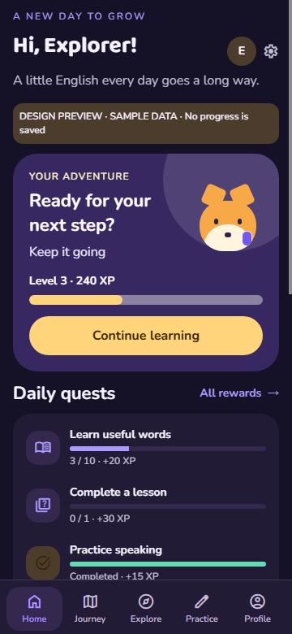
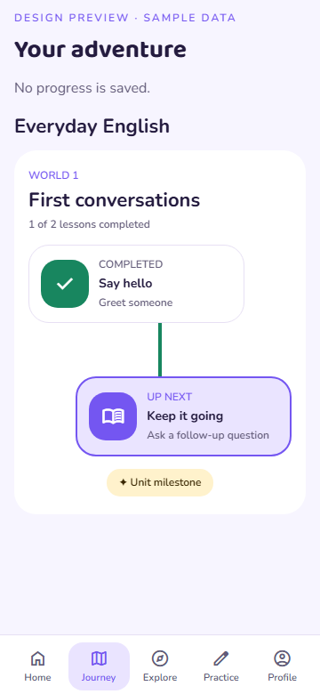
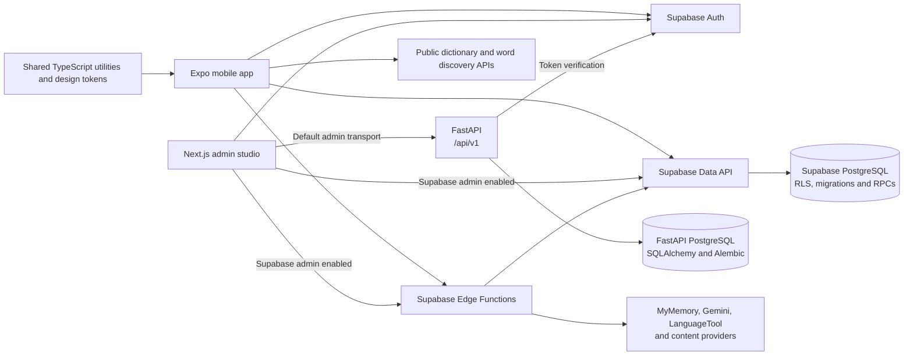

# Englify Quest

**An English-learning app for Vietnamese learners, with bilingual vocabulary, CEFR-guided lessons, and writing feedback.**

[](https://github.com/BayHen/englify-app/actions/workflows/ci.yml)


[Features](#verified-features) | [Screenshots](#screenshots) | [Technology stack](#technology-stack) | [Architecture](#system-architecture) | [Getting started](#getting-started) | [Windows quick start](#quick-start--windows-powershell) | [Environment variables](#environment-variables) | [Development workflow](#development-workflow) | [Troubleshooting](#troubleshooting) | [Deployment](#deployment-and-roadmap)

Englify combines short English lessons, vocabulary review, and skill practice in one mobile app. Guests can look up words and translate between English and Vietnamese. Accounts unlock structured learning, saved vocabulary, and progress tracking. A separate admin studio supports curriculum and question publishing.

## Verified features

Status describes the implementation in this repository. Provider configuration, published content, and remote deployment determine what is available in a particular environment.

| Area | Status | Implementation |
| --- | --- | --- |
| Authentication and guest access | Implemented | Email authentication, registration and recovery, onboarding, guest navigation, and protected routes. [Auth provider](apps/mobile/src/auth/provider.tsx), [routes](apps/mobile/src/app/_layout.tsx) |
| Vocabulary | Implemented | Bilingual lookup, daily words, pronunciation, offline catalog cache, saved words, separate guest and account histories, and flashcards. [Dictionary](apps/mobile/src/features/dictionary), [guest access](docs/GUEST_ACCESS.md) |
| Translation | Implemented with provider dependency | Guest and member English–Vietnamese translation through a quota-limited MyMemory Edge Function. [Translation function](supabase/functions/translate), [configuration](docs/TRANSLATION_API_SETUP.md) |
| Learning Journey and planning | Implemented | CEFR placement, chapters, units, interactive lessons, checkpoints, progress, and a rule-based study plan. [Learning module](apps/mobile/src/features/learning), [plan client](apps/mobile/src/features/plan/api.ts) |
| Speaking and real-world English | Implemented with content dependencies | Device pronunciation and recording for self-review, plus a published reading and dialogue library. [Speaking](apps/mobile/src/features/speaking), [Real English](apps/mobile/src/features/real-english) |
| Quiz Arena and rewards | Implemented | Practice, Time Attack, asynchronous ranking, mistake review, and spaced repetition. Learning XP and rewards have separate rules from Arena scores. [Arena overview](docs/QUIZ_ARENA_V2_1.md), [ranked play](docs/QUIZ_ARENA_V2_3.md), [mistake review](docs/QUIZ_ARENA_V2_4.md) |
| Writing and AI assistance | Implemented with provider dependency | Exercises, offline drafts, daily challenges, revision history, and progress. Optional Gemini coaching and rewrites depend on server-side configuration. [Writing client](apps/mobile/src/features/writing/api.ts), [Edge Functions](supabase/functions) |
| Admin studio | Implemented with two backend paths | Content editing and publishing, curriculum management, CSV/XLSX question import, and AI draft review. The Supabase admin adapter is configurable. [Admin studio](apps/admin/src/app), [admin API routing](apps/admin/src/lib/client.ts) |

## Screenshots

These development captures show an earlier UI revision. Use the [local setup](#getting-started) to explore the current screens.

| Home | Journey |
| --- | --- |
|  |  |

<!-- Future captures: current guest Vocabulary and Translate, interactive lesson, Writing feedback, and admin publishing. -->

## Technology stack

| Layer | Technologies |
| --- | --- |
| Mobile | Expo SDK 58, React Native 0.88, React 19, Expo Router, TypeScript |
| Client state and persistence | React Context, Zustand, TanStack Query, Expo SQLite, Expo SecureStore on native |
| Admin | Next.js 16, React 19, TypeScript, ExcelJS |
| API and data | Supabase Auth, PostgREST, PostgreSQL, SQL migrations, Deno Edge Functions |
| Parallel backend | FastAPI, Pydantic Settings, SQLAlchemy, Alembic, psycopg, Uvicorn |
| Language services | MyMemory translation, Free Dictionary API, Datamuse word discovery, optional LanguageTool and Gemini |
| Tooling and verification | npm workspaces, Docker Compose, ESLint, Ruff, Vitest, Node test runner, pytest, GitHub Actions |

## System architecture



Mobile routes for Journey, Writing, Vocabulary, and rewards use Supabase. Learning plans call the `study-plan` Edge Function. FastAPI still implements overlapping feature endpoints and serves the default admin transport unless the Supabase admin flag is enabled. Its Alembic migrations and the Supabase SQL migrations are distinct setup paths. [Mobile plan client](apps/mobile/src/features/plan/api.ts) | [FastAPI entry point](backend/app/main.py) | [Admin routing](apps/admin/src/lib/client.ts)

## Repository structure

```text
apps/mobile/      Expo routes, learning features, and device storage
apps/admin/       Next.js admin studio and backend adapters
packages/shared/  Shared TypeScript utilities and design tokens
backend/          FastAPI application, Alembic migrations, and Python tests
supabase/         SQL migrations, seed data, Edge Functions, and smoke tests
scripts/          Data import, integration tests, and release verification
docs/             Setup guides, design notes, and feature documentation
.github/workflows/ CI and production readiness checks
```

## Getting started

### First-time setup

Install Node.js 22 or later with npm. Install Python 3.11 or later if you run FastAPI, and Docker if you use Compose or the local Supabase stack. For physical-device testing, use an Expo Go client compatible with the project's Expo SDK 58.

```powershell
git clone https://github.com/BayHen/englify-app.git
cd englify-app
npm.cmd ci
Copy-Item .env.example .env
Copy-Item apps/mobile/.env.example apps/mobile/.env
Copy-Item apps/admin/.env.example apps/admin/.env.local

# FastAPI dependencies
python -m venv .venv
.\.venv\Scripts\python.exe -m pip install -e './backend[dev]'
```

1. **Mobile.** Set the hosted development Supabase URL and its publishable key in `apps/mobile/.env`. The mobile auth validator expects a hosted HTTPS Supabase URL and an `sb_publishable_` key.
2. **Supabase.** Use a dedicated development project. On a fresh project, link it and apply this repository's SQL migrations from the root. Check the target and migration history before running the push. For an existing database, follow the [Supabase setup guide](docs/setup/SUPABASE_SETUP.md) before applying the baseline. Configure the required Edge Functions, enable Email Auth, and allow `englifyquest://auth-callback` and `englifyquest://reset-password`. Use a development build to test custom-scheme callbacks where Expo Go cannot handle them.
3. **FastAPI, if needed.** Configure `ENGLIFY_DATABASE_URL` in the root `.env` for database-backed routes and set the `ENGLIFY_SUPABASE_*` variables for authenticated routes. Set `POSTGRES_PASSWORD` before starting the Compose database. Run Alembic against the development database selected for FastAPI. A local database is enough for schema development, while authenticated endpoints also need the relevant auth-backed records for your test account. The [development guide](docs/DEVELOPMENT.md) describes Compose, CORS, and host configuration.
4. **Admin.** Configure `apps/admin/.env.local` with the Supabase URL and publishable key. Register or create a development account, then grant admin access through the database used by the selected transport. See [admin setup](docs/ADMIN_DASHBOARD.md) for the `admin_members` setup. The default transport uses FastAPI, while `NEXT_PUBLIC_SUPABASE_ADMIN_ENABLED=true` selects the Supabase adapter.

```powershell
# Fresh hosted Supabase development project
npx.cmd supabase link --project-ref YOUR_DEV_PROJECT_REF
npx.cmd supabase db push --dry-run
npx.cmd supabase db push

# Optional FastAPI database on this machine
docker compose up -d db
.\.venv\Scripts\python.exe -m alembic -c backend/alembic.ini upgrade head
```

The Compose API service also supports container development. Its checked-in configuration starts the process, with schema upgrades and Supabase authentication configured separately. For CI-style Supabase tests, use `npx.cmd supabase start -x logflare,vector`. Run `npx.cmd supabase db reset` only against the disposable local stack. The default mobile auth configuration still expects a hosted project.

### Quick Start — Windows PowerShell

After first-time setup, open three PowerShell terminals at the repository root. Start FastAPI when using the default admin transport or working on its endpoints. Supabase-backed mobile features do not need FastAPI. Reinstall dependencies or apply migrations when the relevant files change.

#### Terminal 1 — Mobile Application

```powershell
cd apps/mobile
npx.cmd expo start --tunnel --clear
```

This starts Expo's Metro development server and prints a QR code. Open the project on your phone by scanning the QR code with a compatible Expo Go client. Tunnel mode lets the phone reach Metro when a shared LAN connection is unavailable. The `--clear` flag resets Metro's bundler cache. `npx.cmd` uses the Windows command shim, which works when PowerShell blocks `npx.ps1`. [Expo CLI](https://docs.expo.dev/more/expo-cli/)

#### Terminal 2 — FastAPI Backend

```powershell
.\.venv\Scripts\python.exe -m uvicorn app.main:app --app-dir backend --host 127.0.0.1 --port 8000 --reload
```

The explicit interpreter uses the root virtual environment without manual activation. `--app-dir backend` adds the backend directory to the module search path so Uvicorn can import `app.main` from the repository root. `--reload` restarts the development process when source files change. The API listens at [http://127.0.0.1:8000](http://127.0.0.1:8000), with a [health check](http://127.0.0.1:8000/api/v1/health). A successful health check confirms the process is running. Data routes also need the configured database and schema, and private routes need Supabase authentication settings.

#### Terminal 3 — Admin Dashboard

```powershell
npm.cmd run dev -w apps/admin
```

The root package defines npm workspaces. `-w apps/admin` runs the admin workspace's Next.js development script. Open [http://localhost:3000](http://localhost:3000). The app signs in through Supabase Auth and sends admin requests to FastAPI by default. Enabling the Supabase admin adapter routes supported operations through Supabase instead.

### Local services

| Service | Working directory | Startup | Local URL or connection | Dependencies |
| --- | --- | --- | --- | --- |
| Expo mobile | `apps/mobile` | `npx.cmd expo start --tunnel --clear` | Metro QR code or terminal URL | Hosted development Supabase for connected features and a compatible Expo client for phone testing |
| FastAPI | Repository root | Terminal 2 command above | `http://127.0.0.1:8000` | Root `.venv`. PostgreSQL for data routes and Supabase settings for private routes |
| Next.js admin | Repository root | `npm.cmd run dev -w apps/admin` | `http://localhost:3000` | Supabase Auth and an admin account. FastAPI for default transport, or configured Supabase admin adapter |
| Supabase | Repository root for local CLI | `npx.cmd supabase start -x logflare,vector` for local tests | Hosted project URL for mobile, or `http://127.0.0.1:54321` for local API tests | Hosted project for the standard mobile setup. Docker for the optional local test stack |

### Cross-platform alternatives

On macOS or Linux, use `npm` and `npx` in place of the Windows shims. Use `.venv/bin/python` in place of `.\.venv\Scripts\python.exe`, keeping Uvicorn's `--app-dir backend` when starting from the root. From the root, `npm start -- --clear` starts the mobile workspace and `npm run web -w apps/mobile` starts its web target.

## Environment variables

Use the checked-in examples and keep filled environment files out of Git.

| Variable | Scope | Purpose and requirement |
| --- | --- | --- |
| `EXPO_PUBLIC_SUPABASE_URL`, `EXPO_PUBLIC_SUPABASE_PUBLISHABLE_KEY` | Mobile | Required for Supabase-backed features. Public client settings. |
| `NEXT_PUBLIC_SUPABASE_URL`, `NEXT_PUBLIC_SUPABASE_PUBLISHABLE_KEY` | Admin | Required for admin authentication. Public client settings. |
| `NEXT_PUBLIC_SUPABASE_ADMIN_ENABLED` | Admin | Optional. Set to `true` to select the Supabase admin adapter. |
| `NEXT_PUBLIC_API_URL` | Admin | Optional for local default transport. Set the FastAPI base URL, including `/api/v1`, when the API runs elsewhere. |
| `NEXT_PUBLIC_ADMIN_ATOMIC_CRUD_ENABLED`, `NEXT_PUBLIC_REAL_ENGLISH_HYBRID_ENABLED`, `NEXT_PUBLIC_REAL_ENGLISH_CRON_ENABLED` | Admin | Optional switches for the corresponding Supabase admin workflows. |
| `ENGLIFY_DATABASE_URL`, `POSTGRES_PASSWORD` | FastAPI / Compose | Required respectively for host-based database operations and the Compose stack. |
| `ENGLIFY_SUPABASE_URL`, `ENGLIFY_SUPABASE_PUBLISHABLE_KEY` | FastAPI | Configure Supabase verification for authenticated legacy API routes. |
| `ENGLIFY_ENVIRONMENT`, `ENGLIFY_CORS_ORIGINS` | FastAPI | Environment and explicit allowlist for browser clients. Set for the intended deployment. |
| `TRANSLATE_ALLOWED_ORIGINS`, `EDGE_ALLOWED_ORIGINS` | Edge Functions | Explicit browser origins for translation and applicable Edge routes. |
| `GEMINI_API_KEY`, `GEMINI_MODEL` | Edge Functions | Server-only provider settings for enabled Gemini features. Writing AI also checks feature and budget flags. |
| `LANGUAGETOOL_URL` | Writing grammar function | Optional grammar provider endpoint. |

Supabase project credentials used by Edge Functions stay server-side. Client variables named `EXPO_PUBLIC_*` and `NEXT_PUBLIC_*` are bundled into the application.

## Database and API

Supabase models courses, chapters, units, lessons, and questions separately from learner attempts, saved words, writing submissions, and rewards. SQL migrations define relationships, publishing rules, and operations such as attempt submission and reward reservation. Supabase Auth supplies the user identity. RLS policies and server-side authorization enforce ownership and admin privileges. Guest dictionary queries are limited to published entries, and the guest translation function reserves request quota before contacting its provider. [Migrations](supabase/migrations) | [Database smoke tests](supabase/tests)

FastAPI exposes versioned `/api/v1` routes alongside the Supabase Data API and Edge endpoints. See [API routes](backend/app/api) and [Edge Functions](supabase/functions) for the respective contracts.

## Development workflow

```sh
npm run check
npm run test -w apps/admin
python -m ruff check backend scripts
python -m pytest backend/tests scripts/test_import_educational_content.py
```

`npm run check` covers mobile type checking, linting and tests, shared package type checking, and admin lint/build. The standalone admin test command is also part of CI. There is no root formatting script. The [CI workflow](.github/workflows/ci.yml) also checks Edge Functions, migration upgrades, a clean local database reset, SQL smoke tests, and integration scenarios. [Arena readiness](.github/workflows/arena-production-readiness.yml) checks the linked release environment separately.

## Troubleshooting

| Symptom | What to check |
| --- | --- |
| PowerShell blocks `npm.ps1` or `npx.ps1` | Run `npm.cmd` or `npx.cmd` with the same arguments. |
| Expo tunnel fails or the QR code does not load | Confirm both devices have internet access, retry the tunnel, and check VPN or firewall restrictions. If both devices share a reachable LAN, try `npx.cmd expo start --lan --clear` from `apps/mobile`. [Expo CLI connection modes](https://docs.expo.dev/more/expo-cli/#tunneling) |
| Expo shows stale code or config | Stop Metro, confirm settings in `apps/mobile/.env`, and restart with `--clear`. |
| Expo Go reports an incompatible project | Check the project's SDK 58 against the client version. Use a compatible client or a development build. |
| The virtual environment interpreter is missing | Run `python -m venv .venv` from the root and reinstall `./backend[dev]` using the interpreter in that environment. |
| Uvicorn cannot import `app.main` | Run the exact Terminal 2 command from the repository root so both the interpreter path and `--app-dir backend` resolve correctly. |
| Port 8000 or 3000 is already in use | Run `Get-NetTCPConnection -LocalPort 8000,3000 -State Listen` to identify the listener. Stop your duplicate development server or use another port and update the relevant API URL and CORS origin. |
| Supabase login fails or environment variables are missing | Check the hosted URL, publishable key, Email Auth, and allowed redirects. Mobile reads `apps/mobile/.env`, admin reads `apps/admin/.env.local`, and FastAPI reads the root `.env`. Restart the affected process after changing its settings. |
| Admin cannot load content | With the default transport, verify FastAPI health, the `/api/v1` base URL, CORS, and database access. With the Supabase adapter, verify the selected project's migrations and policies. In either mode, confirm the account has admin membership. |
| A physical phone cannot reach FastAPI | The phone's `localhost` points to the phone. The Expo tunnel connects the phone to Metro only. For a mobile flow that actually calls FastAPI, expose the API on a reachable LAN interface and use the computer's LAN address in the client configuration. The daily backend command binds to loopback for local use. |

## Deployment and roadmap

The repository includes a FastAPI Dockerfile, a Compose development stack, Supabase migration and function configuration, and release verification. This README does not link to an unverified public demo, APK, or hosted admin instance.

A portfolio release can use an isolated Supabase project with published demo content, a reproducible Android build, and a short walkthrough. If the demo uses the default admin transport, provision FastAPI and its database as well. If it uses the Supabase admin transport, validate the corresponding role, RLS, import, and publishing paths first.

Priorities are to document a known-good deployment configuration, verify a full guest-to-member flow in a clean environment, and clarify which legacy API routes are still needed. Build automation for distribution and visual documentation of the current UI remain separate milestones.

## Engineering highlights

- Shared design tokens and tooling across a workspace containing mobile, admin, and backend applications.
- Public guest tools alongside protected learning data, with scoped histories and an offline vocabulary cache.
- Database-backed learning progress, quiz timing and scoring, and reward rules.
- Human-reviewed AI drafts and optional writing feedback with server-side quota checks.
- Migration upgrade checks alongside application unit and integration tests.

## Maintainer and license

[BayHen](https://github.com/BayHen) is the repository owner. A repository-wide license is not declared. The [mobile subdirectory license](apps/mobile/LICENSE) attributes the Expo template to 650 Industries.
