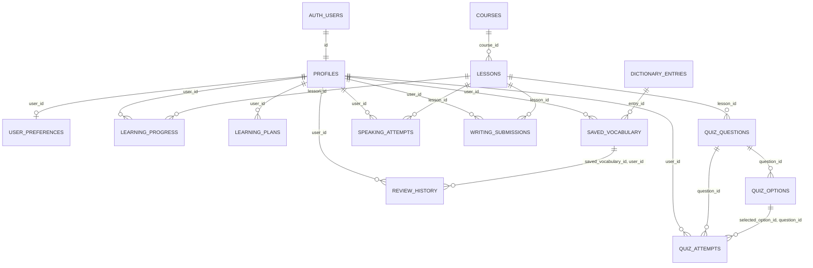
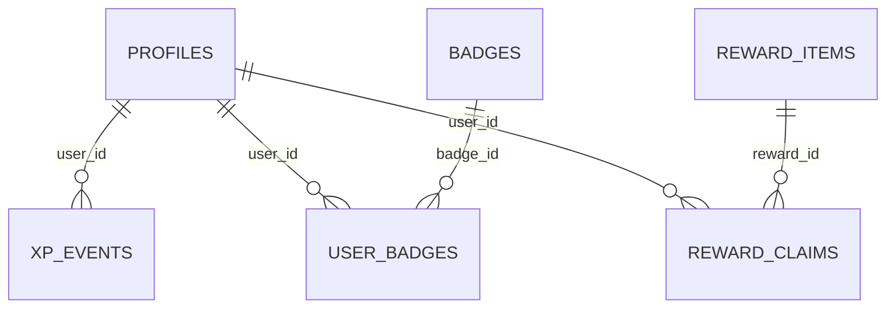
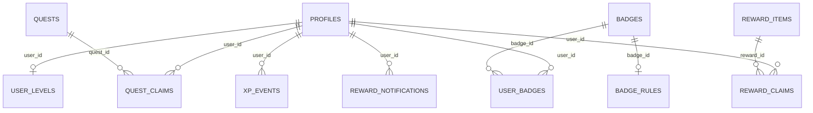

# Kiến trúc PostgreSQL – TASK 03.1

Migration `20261107_10` bổ sung `writing_exercises`, `writing_answer_keys` và `writing_feedback`; mở rộng `writing_submissions` bằng khóa ngoại bài tập và `request_id` để chống gửi trùng. Nội dung gốc và phản hồi được lưu ở hai bảng riêng. Chỉ bài đã xuất bản được đọc qua RLS; bảng đáp án không cấp quyền đọc cho người học; phản hồi chỉ hiện cho chủ bài nộp. Xem [WRITING_PRACTICE.md](WRITING_PRACTICE.md) về API, seed và giới hạn kiểm tra ngữ pháp.

Migration `20261107_09` bổ sung bốn bảng của Real English: nội dung gốc, câu hỏi ngữ cảnh, mục đã lưu và lượt làm quiz. `PROFILES ||--o{ SAVED_EXPRESSIONS`, `REAL_ENGLISH_EXPRESSIONS ||--o{ SAVED_EXPRESSIONS`, `REAL_ENGLISH_EXPRESSIONS ||--o| REAL_ENGLISH_QUIZ_QUESTIONS`, `REAL_ENGLISH_QUIZ_QUESTIONS ||--o{ REAL_ENGLISH_QUIZ_ATTEMPTS`. Xem [REAL_ENGLISH.md](REAL_ENGLISH.md) về nguồn và quyền sử dụng nội dung.

Kế hoạch học theo quy tắc ở migration `20261107_08` thêm `learning_plan_tasks` và chủ đề ưu tiên. Quan hệ mới: `PROFILES ||--o{ LEARNING_PLANS`, `LEARNING_PLANS ||--o{ LEARNING_PLAN_TASKS`, `LESSONS |o--o{ LEARNING_PLAN_TASKS`. Mỗi tác vụ chứa `user_id` và khóa ngoại ghép `(plan_id, user_id)` để ngăn gắn tác vụ với kế hoạch của tài khoản khác. RLS chỉ cấp đọc cho chủ sở hữu. Xem [LEARNING_PLAN.md](LEARNING_PLAN.md) để biết quy tắc tạo, dời và lưu lịch sử.

PostgreSQL là nguồn dữ liệu chính. Migration `20261106_01` tạo 19 bảng ứng dụng trong `public`, không tạo bảng xác thực. Supabase quản lý `auth.users`; `profiles.id` tham chiếu trực tiếp khóa chính này với `ON DELETE CASCADE`. Trigger `on_auth_user_created` tạo profile mặc định khi Auth thêm người dùng và migration bổ sung profile còn thiếu cho người dùng đã tồn tại. Chỉ sao chép `display_name` đã giới hạn 80 ký tự từ metadata; không lấy vai trò hoặc quyền từ metadata do người dùng nhập.

Migration `20261106_02` thêm `learning_goal`, `initial_proficiency` và `onboarding_completed_at` vào `user_preferences`. Dữ liệu cũ giữ nguyên; lựa chọn onboarding được ghi bằng một transaction ở endpoint riêng tư.

Migration `20261106_03` bổ sung IPA và nguồn/giấy phép cho từ điển, cùng chỉ mục tìm kiếm tiền tố. Chi tiết hợp đồng dữ liệu và nguồn seed ở `docs/DICTIONARY.md`.

## Sơ đồ quan hệ





`AUTH_USERS` trong sơ đồ là bảng **do Supabase Auth quản lý**, không thuộc migration. Mọi bảng ứng dụng có khóa chính UUID. Bảng nội dung dùng UUID mặc định `gen_random_uuid()`, còn `profiles.id` lấy UUID từ Auth. Các bảng có `created_at`; bảng có thể sửa có thêm `updated_at` tự cập nhật bằng trigger. Thời gian lưu bằng `timestamptz` (UTC ở tầng ứng dụng).

## Ràng buộc và chỉ mục

- Từ điển có `(language, normalized_term)` duy nhất; khóa học có `slug` duy nhất. Bài học có `(course_id, slug)` và `(course_id, position)` duy nhất; câu hỏi và đáp án có thứ tự duy nhất trong cha. Chỉ một đáp án đúng cho mỗi câu hỏi được bảo đảm bằng partial unique index; quy trình biên tập phải bảo đảm có ít nhất một đáp án đúng trước khi phát hành.
- Tiến độ có `(user_id, lesson_id)` duy nhất và trạng thái hoàn thành phải khớp `completed_at`. Mỗi người có tối đa một kế hoạch `active`. Từ đã lưu có `(user_id, entry_id)` duy nhất. FK ghép `(saved_vocabulary_id, user_id)` ngăn lịch sử ôn tập trỏ sang từ của người khác; FK ghép ở quiz ngăn chọn đáp án của câu hỏi khác.
- `xp_events` là sổ cái XP, duy nhất theo `(user_id, source_type, source_id)` để chống cộng trùng từ cùng một nguồn. Chỉ backend tin cậy được ghi tiến độ, kết quả quiz, XP, huy hiệu và lượt đổi thưởng. Đổi thưởng hiện được backend khóa giao dịch theo người dùng, kiểm tra cấp độ và XP khả dụng, rồi ghi `reward_claims` trong cùng giao dịch.
- Chỉ mục bao phủ tra cứu từ, bài học theo khóa học/thứ tự, tiến độ theo người học/trạng thái, từ đến hạn ôn, lịch sử mới nhất và hoạt động gần đây. FK không nằm đầu một chỉ mục ghép được bổ sung chỉ mục riêng khi cần truy vấn từ phía bản ghi cha.

## Quyền và RLS

RLS được bật trên cả 30 bảng sau migration gamification. `anon` không được cấp quyền bảng. `authenticated` chỉ đọc nội dung được công bố và hàng cá nhân có `auth.uid() = user_id` (riêng profile so theo `id`). Người dùng có thể tự ghi `user_preferences` và `saved_vocabulary`; policy kiểm tra chủ sở hữu ở cả `USING` lẫn `WITH CHECK`. Không cấp quyền ghi trực tiếp cho các bảng tính điểm, tiến độ, bài nói/viết hay nội dung học. `quiz_options` không mở cho client vì có `is_correct`; API sau này phải trả lựa chọn đã bỏ cột đáp án và kiểm tra câu trả lời ở server.

Backend dùng kết nối đặc quyền phải kiểm tra danh tính và quyền ở tầng API, vì role chủ sở hữu/service role có thể bỏ qua RLS. Không đưa service key hoặc chuỗi kết nối vào ứng dụng Expo. Các chính sách tham chiếu `(select auth.uid())` và các cột chủ sở hữu có chỉ mục phù hợp.

## Migration và seed

Yêu cầu PostgreSQL 15+ với Supabase Auth schema/roles đã có. Migration không chạy trên PostgreSQL thuần khi thiếu `auth.users`, `auth.uid()`, `anon`, `authenticated`. Đặt `ENGLIFY_DATABASE_URL` trong `.env` cục bộ, không commit giá trị thật. Từ thư mục gốc:

```powershell
.\.venv\Scripts\python.exe -m alembic -c backend/alembic.ini upgrade head
psql -v ON_ERROR_STOP=1 -d "$env:ENGLIFY_PSQL_URL" -f backend/seeds/development.sql
```

`ENGLIFY_PSQL_URL` là URL PostgreSQL thuần (`postgresql://...`), không dùng URL SQLAlchemy có `+psycopg`. Có thể đặt `PG*` environment variables hoặc dùng Supabase SQL editor để nạp seed. Seed chỉ chứa nội dung học mẫu và chạy lại được; không tạo Auth user hoặc tiến độ giả. File seed bọc trong `BEGIN`/`COMMIT`.

Kiểm thử RLS ở PostgreSQL cục bộ dùng fixture **chỉ cho test** `backend/tests/fixtures/supabase_auth_stub.sql` trên database tạm, sau đó chạy migration, seed, và `backend/tests/sql/rls_and_constraints.sql`. Không chạy fixture này trên Supabase thật. Bài test kiểm tra tạo profile, quyền `anon`, cô lập hai người dùng, ghi sai chủ sở hữu, quyền ghi XP/progress, FK ghép và uniqueness. Không dùng tài khoản hoặc bí mật thật.

## Giới hạn hiện tại

Backend đã có API học tập và gamification; migration SQL vẫn là nguồn schema hiện hành. Alembic tạm tắt `autogenerate` vì metadata ORM chưa bao phủ toàn bộ bảng. Docker Compose hiện cung cấp PostgreSQL thuần cho nền tảng backend; để chạy migration này cần môi trường Supabase hoặc fixture Auth dành riêng cho test như trên. Đừng áp dụng fixture test vào database phát triển lâu dài.
# Learning unit, lesson item, answer key và attempt: xem [LEARNING_ENGINE.md](LEARNING_ENGINE.md).

## Gamification (migration `20261106_07`)

Chi tiết quy tắc và kiểm thử: [GAMIFICATION.md](GAMIFICATION.md). Migration bổ sung cấu hình XP, cấp độ lưu bền, nhiệm vụ ngày/tuần, lượt nhận thưởng nhiệm vụ, quy tắc huy hiệu và thông báo. Sáu bảng mới đều bật RLS, đưa tổng số bảng ứng dụng có RLS lên 30. Client chỉ được đọc nhiệm vụ đang hoạt động và dữ liệu cá nhân của mình; chỉ backend ghi XP, cấp độ, huy hiệu, kết quả nhiệm vụ và thông báo.


