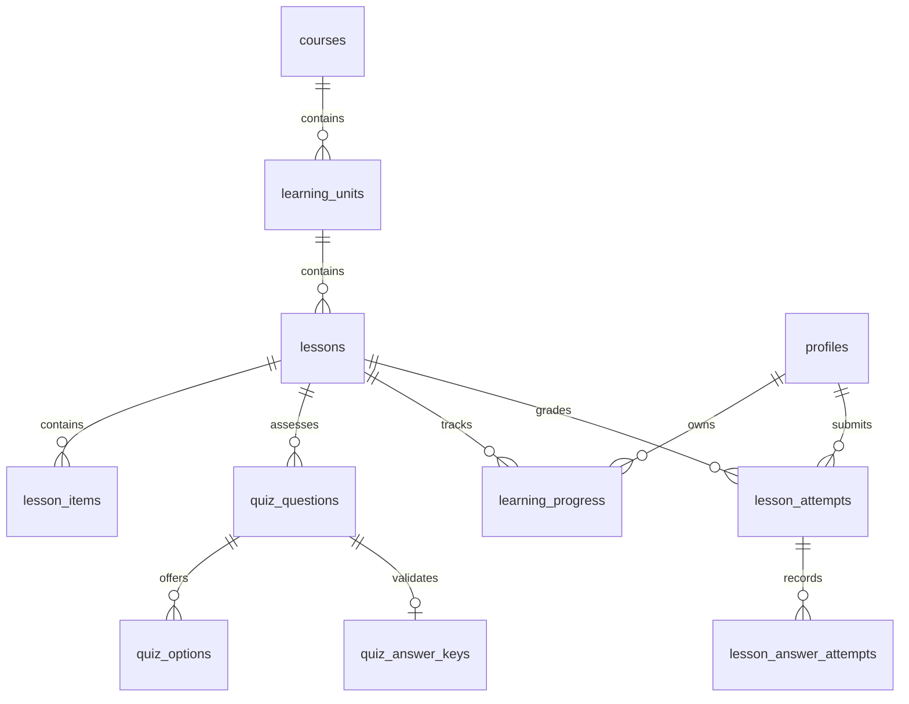

# Learning Journey và Quiz Engine

## Mô hình dữ liệu

Alembic là nguồn chân lý của schema. Migration `20261106_05` mở rộng bảng cũ, không tạo lại Supabase Auth và không xóa bài học đã có. Migration `20261106_06` chặn truy vấn trực tiếp nội dung/câu hỏi của bài bị khóa qua Supabase Data API. Nội dung học đi theo `courses → learning_units → lessons → lesson_items / quiz_questions`. Khóa đáp án nằm ở `quiz_answer_keys` hoặc `quiz_options.is_correct`, không được cấp quyền đọc trực tiếp cho client. `lesson_attempts` lưu một lần nộp; `lesson_answer_attempts` lưu từng câu; `learning_progress` lưu trạng thái; `xp_events` chặn cấp XP trùng bằng unique `(user_id, source_type, source_id)`.

## Luật học và chấm điểm

- Bài đầu tiên của mỗi khóa được mở. Bài tiếp theo chỉ mở khi bài trước có trạng thái `completed` hoặc `mastered` trong PostgreSQL. API kiểm tra lại ở mọi thao tác đọc bài, bắt đầu và nộp bài; thay đổi state trên mobile không mở khóa được.
- `start` chuyển bài `available` thành `in_progress`. Nộp đúng từ **70%** số câu trở lên chuyển thành `completed`. Chơi lại một bài đã đạt với **100%** sau đó chuyển thành `mastered`. Khi đã `mastered`, bài không bị hạ cấp vì lần chơi lại sai.
- Backend so câu trả lời với khóa lưu phía server. Multiple choice dùng ID option; fill blank, grammar và listening chuẩn hóa chữ hoa, khoảng trắng, dấu câu cuối; matching so toàn bộ cặp. Chưa có đánh giá ngữ nghĩa tự do.
- Client tạo `request_id` UUID cho lần nộp. Backend tuần tự hóa các lần nộp của cùng user và ràng buộc unique `(user_id, request_id)`; gửi lại cùng ID trả kết quả đã lưu. Đổi câu trả lời tạo ID mới. XP chỉ phát một lần khi bài đạt lần đầu. Không có nút hay endpoint để client tự ghi `learning_progress` hoặc `xp_events`.
- Tiến độ và kết quả gắn với `profiles.id` từ JWT Supabase, vì vậy đăng xuất/đăng nhập lại đọc cùng dữ liệu. RLS chỉ cho user đọc attempt của mình; chỉ backend có quyền ghi tiến độ và điểm.

## API

Mọi endpoint yêu cầu Bearer access token: `GET /api/v1/journey`, `GET /api/v1/journey/summary`, `GET /api/v1/lessons/{id}`, `POST /api/v1/lessons/{id}/start`, `POST /api/v1/lessons/{id}/submit`, `GET /api/v1/lessons/{id}/attempts`. Dữ liệu nộp gồm `request_id` UUID và `answers` map từ question UUID sang chuỗi hoặc map ghép cặp. API trả `correct_count`, `question_count`, `passed`, `state`, `earned_xp` và thời gian attempt. Không trả đáp án đúng trước khi chấm.

## Dữ liệu DEV và kiểm thử

Chạy `alembic upgrade head`, sau đó `backend/seeds/development.sql` trên database phát triển. Seed có một unit **First conversations** gồm bốn bài và đủ năm dạng câu hỏi. Seed dùng ID cố định, chạy lặp được và không tạo người dùng giả. Bài nghe dùng giọng TTS của thiết bị; chất lượng giọng phụ thuộc Android/iOS và ngôn ngữ đã cài. `speak_text` có trong payload để TTS, nên dạng nghe phục vụ luyện tập, không phải kỳ thi chống gian lận.

`backend/tests/test_learning.py` kiểm tra quy tắc chấm thuần và, khi có `ENGLIFY_TEST_DATABASE_URL` trỏ tới PostgreSQL **tạm** đã migration/seed, kiểm tra hoàn thành cả unit, khóa bài, nộp trùng, XP, chơi lại, cô lập hai user và tiến độ qua phiên API mới. `backend/tests/sql/rls_and_constraints.sql` kiểm tra policy trên database tạm có fixture Auth. Không chạy fixture Auth trên dự án Supabase thật.
