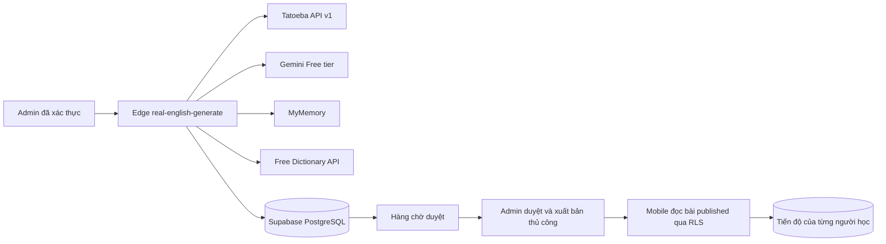

# Real English Hybrid V2 — kế hoạch tương thích và vận hành

> Cập nhật 13/11/2026: Luồng duyệt mới và ba migration đã áp trên Supabase; Function đã deploy. Bài “Ordering Coffee” hiện `archived`, admin phải chọn **Archived → Restore to review → Approve & publish** sau khi kiểm duyệt. Mobile local đã bật feed bài published. Người dùng đã chấp thuận cap 10 request/12.000 output token/ngày; lịch mới 07:00–12:45 ICT đã bật. Năm bài AI thật thuộc năm chủ đề khác nhau hiện `pending_review`; không bài nào tự xuất bản. Xem [báo cáo triển khai](reports/REAL_ENGLISH_EDITORIAL_20261113_REPORT.md) và các SQL tại `supabase/scripts/configure_real_english_five_daily.sql`, `supabase/scripts/enable_real_english_five_daily.sql`. Nội dung bên dưới ghi lại các bước/trạng thái cũ và cần đọc cùng cập nhật này.

> Cập nhật 12/11/2026: lịch tự động một nháp/ngày đã được cài trên Supabase production sau khi kiểm tra bằng transaction rollback. Lịch chạy 07:00 Việt Nam và **chỉ thêm bài vào `in_review`**, không tự xuất bản. Lượt Gemini thủ công hôm nay trả HTTP 404, nên hiện chưa có bài AI nào; lần chạy tự động đầu tiên vào 13/11 cần được kiểm tra trong `cron.job_run_details`, `real_english_generation_jobs` và Admin. Đã xác nhận hai model 2.5/3.5 Flash-Lite khả dụng với key qua `models.get`, chọn `gemini-3.5-flash-lite` cho lượt kế tiếp. Các câu bên dưới nói Cron chưa bật hoặc model 2.5 đang cấu hình mô tả trạng thái **trước** cập nhật này.

Sau 07:00 ngày 13/11, vào Supabase SQL Editor và chạy truy vấn **chỉ đọc** sau, rồi mở Admin → AI lesson review → Refresh queue. Không xuất nội dung Vault hay token:

```sql
SELECT jobname, schedule, active FROM cron.job WHERE jobname = 'englify-real-english-daily';
SELECT status, return_message, start_time FROM cron.job_run_details
WHERE jobid = (SELECT jobid FROM cron.job WHERE jobname = 'englify-real-english-daily')
ORDER BY start_time DESC LIMIT 1;
SELECT status, error_code, error_message, created_at FROM public.real_english_generation_jobs
ORDER BY created_at DESC LIMIT 1;
SELECT id, title, status, created_at FROM public.real_english_lessons
WHERE generation_source = 'hybrid_ai' ORDER BY created_at DESC LIMIT 1;
```

`cron.job_run_details` báo SQL đã gửi yêu cầu HTTP, chưa đủ chứng minh Gemini tạo bài; chỉ tính đạt khi bản ghi cuối có `status='in_review'`, bài xuất hiện trong hàng chờ và admin kiểm tra nguồn/giấy phép trước khi duyệt. Nếu job báo lỗi, không nâng quota hoặc tự xuất bản; xem `error_code`/`error_message` rồi sửa đúng provider.

## Phạm vi hiện có

Ứng dụng đã có danh mục `real_english_expressions`, lưu biểu thức, câu hỏi ngữ cảnh và giao diện `/real-english`. Admin hiện có CRUD nội dung cũ. Những luồng này tiếp tục hoạt động. Nhánh V2 bổ sung bảng bài học riêng và chỉ hiển thị bài V2 sau khi migration, RLS và cờ giao diện được kiểm tra.

`backend/` vẫn có trong checkout này dù bản yêu cầu mô tả rằng backend cũ đã bị xóa. V2 không dùng hoặc khôi phục FastAPI. Nguồn sự thật cho V2 là migration `supabase/migrations/20261111010000_real_english_hybrid_foundation.sql`, Supabase Auth/PostgreSQL/Edge Functions và RLS.

## Kiến trúc



Adapter Tatoeba lọc cặp trực tiếp `eng` → `vie`, kiểm tra cả hai ID, chủ sở hữu, giấy phép và trạng thái duyệt. Chỉ `CC0 1.0` và `CC BY 2.0 FR` có metadata đầy đủ mới đủ điều kiện. Mọi câu nguồn giữ URL và ghi công riêng; lời giải thích/hội thoại do Gemini tạo **không** được gắn nhãn là câu Tatoeba. Không dùng Datamuse. Mẫu kiểm thử `tatoeba-coffee-v1.json` là một phần phản hồi công khai thật ngày 11/11/2026: 20 câu tiếng Anh, 21 cặp trực tiếp, 20 cặp đủ điều kiện theo bộ lọc hiện tại. Từng câu trong mẫu giữ ID, contributor và license để quy chiếu tại `https://api.tatoeba.org/v1/sentences/{id}`; [danh sách ghi công từng câu](TATOEBA_FIXTURE_ATTRIBUTION.md) được tạo từ chính fixture. Không dùng mẫu này làm bài học tự động hoặc người dùng giả.

Giấy phép nguồn: [Tatoeba API v1](https://api.dev.tatoeba.org/openapi.json), [hướng dẫn sử dụng corpus và ghi công](https://en.wiki.tatoeba.org/articles/show/using-the-tatoeba-corpus), [CC0 và bản dịch phái sinh](https://en.wiki.tatoeba.org/articles/show/cc0-contributions). Bản ghi `CC BY 2.0 FR` yêu cầu ghi công tác giả và liên kết nguồn/giấy phép khi sử dụng; cần kiểm tra thủ công điều kiện của từng cặp trước khi phát hành. Không tải hoặc tái sử dụng audio Tatoeba. Mobile dùng giọng TTS thiết bị.

## Dữ liệu và quyền

Migration cộng thêm `real_english_topics`, `real_english_lessons`, `real_english_phrases`, `real_english_dialogues`, `real_english_dialogue_lines`, `real_english_source_references`, `real_english_generation_jobs`, `real_english_review_history`, `real_english_generation_settings`, `real_english_user_progress`. Không xóa bảng/tiến độ cũ. UUID, FK, unique/hash, chỉ mục, UTC timestamps và RLS được khai báo trong migration. `englify_is_admin()` từ migration Admin trước đó là điều kiện tiên quyết. Người học chỉ đọc bài `published`; tiến độ chỉ thuộc UID của họ. Các bảng job/settings/review dành cho admin hoặc service role. RPC ghi nháp nguyên tử để không tạo bài học nửa chừng; mỗi slot có khóa idempotency và lease. Bài `hybrid_ai` chỉ xuất bản khi có ít nhất một cụm từ, nguồn đủ điều kiện và đã qua bước phê duyệt thủ công.

Trạng thái: `draft` → `in_review` → `approved` → `published`; có `rejected` và `archived`. Trigger ghi lịch sử khi admin đổi trạng thái. Nội dung đang published không được sửa trực tiếp; lưu trữ bản cũ rồi tạo phiên bản mới. Người học không thể xóa trạng thái hoàn thành bằng update thông thường.

## Cấu hình an toàn

Trong Supabase Edge Secrets (không đặt trong mobile/Admin public env): `GEMINI_API_KEY`, `GEMINI_MODEL=gemini-2.5-flash-lite`, `AI_GENERATION_ENABLED`, `AI_FREE_TIER_CONFIRMED`, `AI_DAILY_MAX_REQUESTS`, `AI_DAILY_MAX_OUTPUT_TOKENS`, `AI_MONTHLY_MAX_ESTIMATED_COST_USD=0`, `EDGE_ALLOWED_ORIGINS`. Function từ chối gọi Gemini nếu model khác allowlist, thiếu cờ Free tier, cap tiền khác 0, hoặc quota cấu hình không an toàn. Cần xác minh **tier và hạn mức thực tế của chính project** trong Google AI Studio; việc có key chưa chứng minh Free tier. Không đưa thông tin cá nhân người học vào prompt. [Bảng giá Gemini](https://ai.google.dev/gemini-api/docs/pricing), [hạn mức theo project/model](https://ai.google.dev/gemini-api/docs/rate-limits), [structured output](https://ai.google.dev/gemini-api/docs/structured-output).

MyMemory chỉ cung cấp ứng viên nghĩa để admin so sánh, không tự ghi đè nghĩa từ Gemini. Nếu provider lỗi, nháp giữ cảnh báo; không bịa nghĩa hoặc IPA. Adapter Free Dictionary chỉ tra IPA/từ loại cho từ đơn nếu dữ liệu hợp lệ; cụm nhiều từ không bị giả mạo IPA. Cờ server `DICTIONARY_ENRICHMENT_ENABLED=false` mặc định, chỉ bật sau khi rà quyền dữ liệu đầu ra.
API Free Dictionary công bố endpoint và cấu trúc `phonetic`/`meanings.partOfSpeech` tại [trang chính thức](https://dictionaryapi.dev/); [mã máy chủ](https://github.com/meetDeveloper/freeDictionaryAPI) ghi GPL-3.0 cho code, nhưng chưa làm rõ riêng quyền tái phân phối mọi dữ liệu trả về. V2 không sao chép định nghĩa hoặc audio. Cần rà quyền sử dụng dữ liệu đầu ra trước khi bật cờ. Lần gọi API từ môi trường phát triển này trả HTTP 403, nên khả năng enrichment trực tiếp còn phải kiểm tra trên Edge sau deploy; khi lỗi, chức năng chỉ ghi cảnh báo.

## Trình tự kích hoạt

**Cập nhật 12/11/2026:** Hai migration `20261110170000_admin_rls_foundation.sql` và `20261111010000_real_english_hybrid_foundation.sql` đã áp vào project đang dùng sau một lần chạy thử rollback thành công. Function `real-english-generate` đã ACTIVE với `verify_jwt=true`. Truy vấn đọc xác nhận bảng/RPC/RLS; admin hiện có thể đọc cấu hình, người không thuộc admin không thấy cấu hình, anonymous gọi bảng bài học nhận HTTP 401. Cờ UI đã bật trong `.env.local` cục bộ; người dùng xác nhận hàng chờ và biểu mẫu mới đã hiện. Cron **chưa bật**. Tạo bài thật và thao tác duyệt/xuất bản trong trình duyệt vẫn phải kiểm thử. Lịch sử `supabase_migrations` của project vẫn chưa khớp các file migration cũ; không chạy `db push --remote` hàng loạt.

**Bật thử Free tier:** người dùng đã xác nhận project Gemini ở Free tier, không bật billing và cho phép tối đa 1 yêu cầu/ngày. Theo [bảng giá chính thức](https://ai.google.dev/gemini-api/docs/pricing), `gemini-2.5-flash-lite` còn có Free tier; [giới hạn thực tế](https://ai.google.dev/gemini-api/docs/rate-limits) phụ thuộc project và cần xem trong AI Studio. Edge Secrets đã đặt model, cờ Free tier, cap 0 USD, 1 request/ngày và tối đa 1.200 output tokens; không thay `GEMINI_API_KEY`. DB settings đã bật tạo nháp thủ công/Tatoeba cho đúng một chủ đề `coffee-conversation`, 1 slot/ngày. Không cài Cron, không tự xuất bản.

Lượt thử đầu tiên thất bại **trước Gemini**: Tatoeba mất hơn timeout cũ 8 giây; Admin sau đó nhận lỗi quota. Kiểm tra API thật chỉ ra URL cũ dùng đồng thời `showtrans=matching` và `showtrans:lang`, bị Tatoeba từ chối HTTP 400. Theo [hướng dẫn API v1 của Tatoeba](https://en.wiki.tatoeba.org/articles/show/api-migration-v1), cần chọn một cách lọc hiển thị bản dịch; URL mới dùng `showtrans=matching` cùng bộ lọc `trans:*`. Thử adapter với từ `coffee` sau sửa trả 21 cặp, 20 cặp đủ điều kiện metadata, mất khoảng 18 giây. Timeout Tatoeba đã nâng lên 30 giây có đo đạc; lookup nguồn được chuyển trước bước giữ quota Gemini. Migration `20261112010000_real_english_source_preflight.sql` phân loại job timeout cũ và cho phép thử lại mà không tăng giới hạn Gemini 1 lượt/ngày; đã qua smoke test local có rollback, production dry-run rollback, rồi áp và deploy lại Function. Admin có khóa gửi trùng đồng bộ. Lượt thử sau sửa vẫn cần xác nhận từ phiên Admin.

Để tránh sửa CORS production, thao tác **Generate review draft** của Admin đi qua `/api/hybrid-generate` trên cùng origin. Route chỉ chuyển tiếp nội dung tối đa 2.000 ký tự tới Function cố định, không ghi token; Function vẫn tự xác thực JWT và RPC admin. Kiểm tra sự tồn tại của Function đi qua `/api/hybrid-function-status`. Bộ duyệt tự động đã từ chối thêm localhost vào `EDGE_ALLOWED_ORIGINS` trên production vì đây là thay đổi quyền truy cập ngoài phạm vi deploy; route cùng origin là giải pháp an toàn đã được áp dụng. Không cần thêm origin localhost vào Edge Secrets để Admin hoạt động.

Trang Admin **AI lesson review setup** hiện có nút **Check again**. Nút này chỉ đọc phiên Supabase, kiểm tra sự tồn tại của `real_english_lessons` bằng GET, gọi RPC `englify_is_admin()` và gọi API route cùng origin để kiểm tra Edge Function bằng GET (không tạo bài, không gọi Gemini). Route cùng origin tránh việc trình duyệt báo lỗi CORS chung chung khi gateway trả 404 trước khi Function tồn tại. Kết quả 404 của bảng hoặc Function nghĩa là phần tương ứng chưa có trên project đang kết nối; 405 từ Function nghĩa là Function đã nhận yêu cầu nhưng từ chối phương thức GET như dự kiến. Kết quả kiểm tra không thay thế kiểm thử tạo nháp, duyệt và xuất bản. Sau khi áp migration và deploy, bấm **Check again** rồi mới bật cờ giao diện.

Nếu Admin chỉ hiện thư viện Real English cũ hoặc trang setup, hãy cập nhật mã trên branch `feature/real-english-hybrid-v2`, đặt `NEXT_PUBLIC_REAL_ENGLISH_HYBRID_ENABLED=true` trong `apps/admin/.env.local`, rồi khởi động lại `npm.cmd run dev -w apps/admin` từ thư mục gốc và mở `http://localhost:3000`. Ngày 12/11/2026, migration/RLS và Function trên project đang dùng đã được triển khai; lỗi HTTP 404 trước đó là trạng thái **trước** triển khai. Nếu trang setup còn hiện sau khi restart, kiểm tra cờ ở đúng file môi trường và không dán nội dung `.env.local` vào chat.

1. Resume Docker Desktop. Dùng Supabase **cục bộ riêng** để áp migration từ đầu và kiểm tra RLS bằng hai tài khoản thử tạo qua Supabase Auth. Không chạy `db reset` trên cơ sở dữ liệu chứa dữ liệu cần giữ.
   Đã có smoke test chạy trên PostgreSQL 18 tạm riêng (`supabase/tests/hybrid_smoke_setup.sql`, `hybrid_smoke_test.sql`, `hybrid_job_smoke_test.sql`) để kiểm tra cú pháp và logic cơ bản. Các tệp này dựng Auth tối giản; **không** chạy `hybrid_smoke_setup.sql` trên Supabase thật và không coi kết quả đó là kiểm chứng tích hợp Supabase.
2. Chạy `npx.cmd supabase db push --dry-run`, sau đó `npx.cmd supabase db push` trên local. Kiểm tra bảng, FK, trigger, RLS, tạo nháp, duyệt, publish, đọc learner, và trạng thái tiến độ.
3. Kiểm tra migration Admin tiền nhiệm đã có trên môi trường đích. Dry-run ngày 11/11 cho thấy CLI muốn đẩy toàn bộ baseline và migration cũ lên production, dù ứng dụng đã có dữ liệu thật. Phải đối chiếu `supabase_migrations.schema_migrations` và schema production bằng thao tác chỉ đọc, rồi lập phương án đồng bộ lịch sử migration không phá dữ liệu. Không chạy `db push --remote` trong trạng thái hiện tại.
   Trong SQL Editor của Supabase, quản trị viên có thể kiểm tra **chỉ metadata** bằng `SELECT version FROM supabase_migrations.schema_migrations ORDER BY version;` và `SELECT to_regclass('public.real_english_expressions'), to_regclass('public.admin_members'), to_regclass('public.real_english_lessons');`. Không xuất dữ liệu người dùng. Automatic approval review đã từ chối thao tác `supabase db dump --remote --schema public` vì CLI không có cờ `--schema-only` và có nguy cơ kéo dữ liệu nhạy cảm về máy; không dùng lệnh đó để đối chiếu.
4. Deploy `npx.cmd supabase functions deploy real-english-generate --use-api` sau khi migration đã áp và xác minh; **không** dùng `--no-verify-jwt`. Cấu hình secrets ở máy/quản trị Supabase, không commit giá trị thật.
5. Kiểm tra admin/learner bằng hai tài khoản: learner không thấy bản nháp, không sửa được; admin tạo nháp, xem provenance, duyệt/phủ quyết/xuất bản; mobile chỉ thấy bài published. Bật `NEXT_PUBLIC_REAL_ENGLISH_HYBRID_ENABLED=true` và `EXPO_PUBLIC_REAL_ENGLISH_LESSONS_ENABLED=true` sau các kiểm tra này.
6. Chỉ thiết lập Cron 00:00 UTC (07:00 Việt Nam) khi Tatoeba/Gemini/MyMemory/Dictionary, quota, idempotency, RLS và kiểm thử đầu cuối đều đạt. Script chuẩn bị tại `supabase/scripts/enable_real_english_cron.sql`, **chưa chạy**. Trước khi chạy, bật `pg_cron`/`pg_net`, tạo ba mục Vault được ghi trong phần đầu script (URL Edge, anon JWT cũ dùng qua gateway, secret Cron ngẫu nhiên ít nhất 32 ký tự), đặt cùng secret Cron vào Edge Secrets và kiểm tra múi giờ Cron. Không đặt service-role key trong Cron hoặc client. Hiện **chưa cài lịch Cron**, chưa bật auto generation và chưa xuất bản tự động. Mục tiêu 5 nháp/ngày là mục tiêu tối đa, không cam kết nếu provider/quota không đáp ứng. [Cách Supabase lập lịch Edge Functions](https://supabase.com/docs/guides/functions/schedule-functions).

## Lệnh kiểm tra

```powershell
npm.cmd run typecheck -w apps/mobile
npm.cmd run lint -w apps/mobile
npm.cmd run test -w apps/mobile
npm.cmd run lint -w apps/admin
npm.cmd run build -w apps/admin
npx.cmd tsc --noEmit --target ES2022 --lib es2022,dom --module esnext --moduleResolution bundler --allowImportingTsExtensions --skipLibCheck supabase/functions/real-english-generate/index.ts supabase/functions/_shared/tatoeba.ts supabase/functions/_shared/real-english-generator.ts supabase/functions/_shared/real-english-enrichment.ts
cd apps/mobile
npx.cmd expo start --tunnel --clear
```

Kiểm tra Expo Go trên iOS/Android và React Native Web phải thực hiện sau khi bật cờ với dữ liệu thật. Export web chỉ chứng minh bundle; phải mở `/real-english` và thử bài, bookmark, hoàn thành, quay lại, tải lại; kiểm tra Console/LogBox có lỗi `Unexpected text node` hay không.
